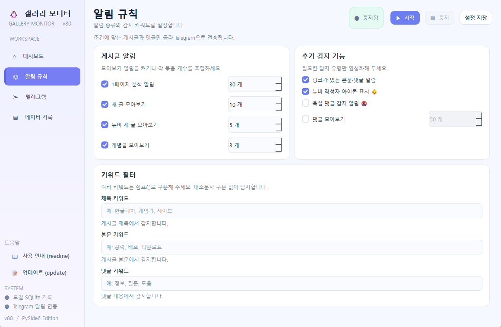

# 갤러리 모니터

<ime src="https://github.com/tokis-codex/dcgall-monitoring/blob/main/preview1.png">


## 목차

1. [주요 기능](#1-주요-기능)
2. [설치 및 실행](#2-설치-및-실행)
3. [처음 사용하는 방법](#3-처음-사용하는-방법)
4. [화면 구성](#4-화면-구성)
5. [모니터링 설정](#5-모니터링-설정)
6. [알림 규칙과 Telegram](#6-알림-규칙과-telegram)
7. [실행·중지·트레이](#7-실행중지트레이)
8. [데이터 기록과 파일 관리](#8-데이터-기록과-파일-관리)
9. [업데이트 및 백업](#9-업데이트-및-백업)
10. [문제 해결](#10-문제-해결)
11. [개발자용: 소스 실행 및 Windows 빌드](#11-개발자용-소스-실행-및-windows-빌드)
12. [GitHub 배포](#12-github-배포)
13. [보안·개인정보·유의 사항](#13-보안개인정보유의-사항)

---

## 1. 주요 기능

- 디시인사이드 **게시판 목록, 최근 게시글, 개념글, 게시글 본문, 댓글** 확인
- 제목·본문·댓글의 **사용자 지정 키워드** 감지(쉼표 구분, 대소문자 구분 없음)
- 새 글/개념글 **묶음 알림**, 첫 페이지 제목의 **주제·반복 단어 요약**
- 본문·댓글 **외부 링크 탐지**(링크 알림에서는 `dclottery`, `youtube`, `youtu.be`가 포함된 URL 제외)
- 댓글의 **욕설 표현 감지**(내장 규칙에 따른 문자열 탐지)
- 관찰 이력을 기반으로 한 **신규 작성자(뉴비) 판정** 및 👶 표시
- Telegram 봇을 통한 알림 및 **상황별 예시 메시지 테스트 전송**
- **SQLite 로컬 DB**에 확인·알림·댓글·작성자 관련 이력 저장 및 중복 전송 방지
- **실시간 실행 로그**, 별도 DB 조회기, 펭귄 아이콘
- 창 **닫기(X) → 트레이 숨김**, 트레이에서 창 복원 또는 프로그램 완전 종료

> **범위:** 이 버전의 대시보드에는 다중 갤러리 체크리스트나 실시간 게시글 피드가 없습니다. 기본 설정은 **게시판 주소 1개**를 대상으로 합니다.

## 2. 설치 및 실행

### 배포 ZIP(일반 사용자)

1. GitHub **Releases**에서 Windows x64용 포터블 ZIP을 내려받습니다.
2. ZIP을 **쓰기 권한이 있는 폴더**(예: 사용자 문서 폴더)에 압축 해제합니다.
3. `GalleryMonitor.exe`를 실행합니다. 별도의 Python 설치는 필요하지 않도록 빌드하는 구성입니다.
4. 기록만 확인하려면 `GalleryDatabaseViewer.exe`를 따로 실행할 수 있습니다.

배포 ZIP의 구성은 다음과 같습니다.

```text
GalleryMonitor_<태그>_Windows_x64/
├─ GalleryMonitor.exe          # 메인 프로그램
├─ GalleryDatabaseViewer.exe   # SQLite 데이터 조회기
├─ readme.txt                  # 사용자 설명서
└─ update.txt                  # 업데이트 내역
```

> GitHub Actions로 위 ZIP을 생성하도록 설정되어 있습니다. **현재 제공된 소스 ZIP 자체에는 EXE가 들어 있지 않습니다.** 실행 파일의 실제 빌드 성공과 Windows 동작은 릴리스 전 확인하세요.

### 기본 실행 위치

`config.json`(설정)과 `monitor_state.sqlite3`(데이터베이스)는 **EXE가 있는 폴더**에 생성·저장됩니다. 쓰기 권한이 제한된 폴더보다 개인 폴더에서 사용하는 편이 안전합니다.

## 3. 처음 사용하는 방법

1. 메인 프로그램을 실행하고 **대시보드**에서 모니터링할 디시인사이드 게시판 주소를 확인합니다.
2. `1페이지 분석 주기`, `키워드 검사 주기`, `새 글 모아보기 주기`, `최근 게시글 확인 수`, `게시판 요청 간격`을 조절합니다.
3. **알림 규칙**에서 사용할 알림 종류를 선택하고 제목·본문·댓글 키워드를 입력합니다. 여러 단어는 **쉼표(,)**로 구분합니다.
4. **텔레그램**에서 Bot Token 및 Chat ID를 입력합니다. 필요하면 `발급 방법 보기 ↗`를 확인합니다.
5. `테스트 알림 전송`으로 연결을 점검합니다. **이 버튼은 실제 게시글이 아닌 여러 종류의 예시 메시지를 전송**하므로 채팅방에 여러 메시지가 도착할 수 있습니다.
6. 상단의 **설정 저장**을 누른 뒤 **시작**을 누릅니다. `시작`을 누를 때에도 현재 설정이 자동 저장됩니다.
7. 상태 표시와 대시보드 **오른쪽 실시간 실행 로그**를 확인합니다. 중지할 때는 상단 **중지**를 누릅니다.

**첫 실행 주의:** 앱 시작 직후, Telegram Token과 Chat ID가 이미 설정되어 있으면 기존 v80의 **초기 주제/제목 확인** 작업이 별도로 실행될 수 있습니다. 따라서 설정과 DB를 복사해 둔 환경에서는 **시작 버튼을 누르기 전에도 알림이 발생할 수 있습니다.** DB가 없으면 `readme.txt`, `update.txt`의 내용을 로그에 안내합니다.

## 4. 화면 구성

| 화면 | 실제 제공하는 기능 |
| --- | --- |
| **대시보드** | 상단 상태·시작/중지/설정 저장, 그라데이션 배너, 상태 카드 3개, 모니터링 기본 설정, **오른쪽 세로형 실시간 실행 로그** 및 `로그 지우기` |
| **알림 규칙** | 게시글 알림, 추가 감지 기능, 제목·본문·댓글 키워드 설정 |
| **텔레그램** | Bot Token, Chat ID, 토큰 표시, 발급 방법 안내, 테스트 알림 전송, 보안 안내 |
| **데이터 기록** | 저장된 SQLite DB의 기록 조회·파일 선택·새로고침 및 일부 항목 링크 열기 |

왼쪽 사이드바에는 `사용 안내 (readme)`와 `업데이트 (update)` 버튼도 있습니다. 해당 버튼은 EXE 폴더에 있는 `readme.txt`, `update.txt`를 엽니다.

**UI 사용 팁:** 숫자 입력란은 마우스 휠로 값이 바뀌지 않습니다. 오른쪽 ▲▼ 버튼 또는 키보드로 변경하세요. `로그 지우기`는 화면에 표시된 로그를 비우는 기능이며 **SQLite 기록 삭제 기능이 아닙니다.**

## 5. 모니터링 설정

대시보드의 **모니터링 기본 설정**에서 다음 값을 조정합니다.

| 설정 | 기본값 | 설명 |
| --- | ---: | --- |
| 모니터링 게시판 주소 | `https://gall.dcinside.com/mgallery/board/lists/?id=retrogame` | 대상 게시판 목록 URL |
| 1페이지 분석 주기 | 30분 | 제목·주제 요약 확인 간격 |
| 키워드 검사 주기 | 5분 | 최근 게시글/본문/댓글 탐지 작업 간격 |
| 새 글 모아보기 주기 | 5분 | 새 글 제목과 개념글 확인 간격 |
| 최근 게시글 확인 수 | 30개 | 1~200개 범위에서 최근 글 검사 |
| 게시판 요청 간격 | 5초 | 요청 사이 최소 대기 시간, 1초 이상 |

- 주기 및 개수 입력은 양의 정수만 받습니다. 확인 글 수의 최대치는 **200개**입니다.
- 원본 엔진은 게시판 목록 캐시를 사용하며 상세글·댓글을 확인할 수 있습니다. 대상 페이지의 구조 변경이나 네트워크 오류로 일부 내용이 누락될 수 있습니다.
- 설정 변경은 **현재 실행 중인 모니터링 작업에 즉시 적용되지 않습니다.** **중지 → 시작**으로 적용하세요. 진행 중인 네트워크 요청이 끝나기를 기다려야 할 수 있습니다.
- 디시인사이드에 불필요한 요청이 집중되지 않도록 여유 있는 주기를 권장합니다.

## 6. 알림 규칙과 Telegram

### 게시글 알림

| 알림 종류 | 기본값 | 설정 내용 |
| --- | --- | --- |
| 1페이지 분석 알림 | 켜짐 / 30개 | 누적 새 글 수가 기준에 도달하면 첫 페이지 제목의 반복 단어 등을 요약 |
| 새 글 모아보기 | 켜짐 / 10개 | 새 글 제목을 묶어서 전송 |
| 뉴비 새 글 모아보기 | 켜짐 / 5개 | 새 작성자의 글을 묶어서 전송 |
| 개념글 모아보기 | 켜짐 / 3개 | 새 개념글을 묶어서 전송 |

### 추가 감지 기능

| 기능 | 기본값 | 설명 |
| --- | --- | --- |
| 링크가 있는 본문·댓글 알림 | 켜짐 | 본문·댓글 URL 탐지; 일부 서비스 링크 제외 |
| 뉴비 작성자 아이콘 표시 👶 | 켜짐 | 기존 관찰 이력과 비교해 새 작성자로 판정한 경우 표시 |
| 욕설 댓글 감지 알림 🤬 | 꺼짐 | 내장 욕설 목록·문자 정규화 규칙으로 감지 |
| 댓글 모아보기 | 꺼짐 / 50개 | 수집된 새 댓글을 지정 개수로 묶어 알림 |

**키워드 필터**에는 `제목 키워드`, `본문 키워드`, `댓글 키워드`가 따로 있습니다. 예: `한글패치, 배포, 공략`. 탐지된 단어는 Telegram 메시지에서 강조 표시될 수 있습니다.

**뉴비 판정의 한계:** 게시판의 모든 과거 작성자 정보와 대조하는 방식이 아닙니다. 최근 글을 기반으로 작성자 기준점을 쌓으므로 확인 범위, 삭제된 글, IP 변경 등에 따라 실제 신규 작성자와 다르게 판단할 수 있습니다.

### Telegram 연결

- BotFather에서 발급받은 **Bot Token**과 알림을 받을 **Chat ID**를 입력합니다.
- `토큰 표시`를 체크하면 입력된 토큰을 화면에서 확인할 수 있습니다.
- `테스트 알림 전송`은 **예시 알림 여러 개**를 실제 채팅방으로 보냅니다. 테스트 전에 대상 Chat ID가 올바른지 확인하세요.
- Bot Token/Chat ID가 비어 있으면 모니터링 시작 시 안내창이 나타나고 시작하지 않습니다.
- 키워드 세 칸이 모두 비어 있으면 키워드 없음 안내창이 나타납니다. 사용자가 계속 진행하도록 선택할 수 있습니다.

## 7. 실행·중지·트레이

| 조작 | 동작 |
| --- | --- |
| **시작** | 현재 설정 저장 후 주제·키워드·새 글 확인 작업 실행 |
| **중지** | 중지 요청 후 시작 버튼 즉시 재활성화, 진행 중 요청이 끝나면 작업 종료 |
| 중지 직후 **시작** | 이전 작업이 아직 종료되지 않았으면 **재시작 대기**로 전환; 종료 후 다시 시작해 중복 실행 방지 |
| 창 오른쪽 위 **X** | 시스템 트레이가 지원될 때 **창만 숨김**; 모니터링 계속 진행 |
| 트레이 펭귄 **더블클릭** | 창 다시 표시 |
| 트레이 메뉴 **창 열기** | 창 다시 표시 |
| 트레이 메뉴 **프로그램 종료** | 실행 중 작업에 종료를 요청하고 앱 완전 종료 |

- 트레이가 지원되지 않는 환경에서는 X를 누르면 일반적인 창 종료로 동작할 수 있습니다.
- 모니터링을 완전히 멈추려면 **중지**, 앱까지 끝내려면 트레이 메뉴 **프로그램 종료**를 사용하세요.
- 로그는 최근 최대 **5,000줄(블록)** 정도를 화면에 유지하도록 설정되어 있습니다.

## 8. 데이터 기록과 파일 관리

### 기록 조회

대시보드 왼쪽의 **데이터 기록**에서 `monitor_state.sqlite3`를 읽습니다. 이 탭 또는 별도 `GalleryDatabaseViewer.exe`에서 `파일 선택`으로 다른 DB를 고르고 `새로고침`할 수 있습니다.

DB 조회기는 다음 **6개 탭**을 제공합니다.

1. **알림 전송 내역** — Telegram으로 보낸 알림 메시지와 시각
2. **전송한 새 글 제목** — 저장된 글 제목·URL·기록 시각
3. **확인한 항목** — 중복 감지를 위한 확인 식별자·시각
4. **작성자·식별코드** — 작성자 관찰 이력
5. **뉴비 감지 내역** — 작성자·글·댓글 관련 탐지 내역
6. **확인한 댓글** — 댓글 내용·작성자·원문 링크

조회기는 DB를 **읽기 전용**으로 열고, 테이블의 데이터를 수정하지 않습니다. 링크가 있는 기록의 **행을 더블클릭**하면 기본 브라우저로 원문을 엽니다. DB가 아직 생성되지 않았다면 `파일을 찾을 수 없습니다`라고 표시됩니다.

### 저장 파일

| 파일 | 용도 | 배포 시 취급 |
| --- | --- | --- |
| `config.json` | 게시판·주기·키워드·Bot Token·Chat ID 설정 | **개인 파일 — GitHub 업로드 금지** |
| `monitor_state.sqlite3` | 수집·알림·작성자·댓글 등 SQLite 이력 | **개인 파일 — GitHub 업로드 금지** |
| `readme.txt` | 사용 설명서(앱 내 도움말 버튼에서 열림) | 배포 ZIP에 포함 |
| `update.txt` | 업데이트 내역 | 배포 ZIP에 포함 |

## 9. 업데이트 및 백업

1. **트레이 메뉴 → 프로그램 종료**로 기존 프로그램을 완전히 끝냅니다.
2. 기존 실행 폴더의 `config.json`, `monitor_state.sqlite3`를 안전한 곳에 **백업**합니다.
3. 새 버전 ZIP을 별도 폴더에 압축 해제합니다.
4. 백업한 두 파일을 새 `GalleryMonitor.exe`와 **같은 폴더**로 복사합니다.
5. 프로그램을 실행한 뒤 설정·데이터 기록을 확인합니다.

기존 v80의 설정 키와 SQLite 구조를 유지하는 코드이지만, **사용 중인 개인 DB의 모든 버전별 이관 테스트가 완료되었다는 의미는 아닙니다.** 중요한 이력은 반드시 백업하세요. `monitor_state.sqlite3`를 삭제하면 저장된 중복 방지·작성자·알림 이력도 사라집니다.

## 10. 문제 해결

| 증상 | 확인 사항 |
| --- | --- |
| `시작`이 동작하지 않음 | 게시판 주소와 Telegram Bot Token/Chat ID를 입력했는지 확인하세요. 키워드 없음 확인창이 떠 있는지도 확인합니다. |
| Telegram 알림이 오지 않음 | Bot Token·Chat ID, 봇의 채팅 접근 권한, 인터넷 연결, 텔레그램 탭의 테스트 알림 결과를 확인하세요. |
| `중지`를 눌렀지만 종료 대기 상태 | 진행 중인 네트워크 요청이 끝나기를 기다리는 경우입니다. `시작`을 누르면 중복 실행 대신 재시작이 예약됩니다. |
| 창이 닫혔는데 프로그램이 남아 있음 | 정상적인 **트레이 숨김** 동작입니다. 작업 표시줄 알림 영역(숨겨진 아이콘 포함)의 펭귄 아이콘을 확인하세요. |
| DB 파일을 찾을 수 없음 | EXE 폴더의 `monitor_state.sqlite3` 존재 여부를 확인하세요. 아직 모니터링 이력이 없다면 DB가 만들어지지 않았을 수 있습니다. |
| 설정이 저장되지 않음 | EXE 폴더에 쓰기 권한이 있는지, 다른 프로그램이 파일을 잠그는지 확인하세요. |
| 게시글·댓글이 수집되지 않음 | 게시판 URL, 네트워크, 요청 간격, 사이트 HTML·댓글 API 구조 변경 여부를 확인하세요. |
| 숫자가 휠로 바뀌지 않음 | 의도된 동작입니다. 숫자 칸의 ▲▼ 버튼이나 키보드를 사용하세요. |
| 앱 내 설명서가 열리지 않음 | EXE 폴더에 `readme.txt`/`update.txt`가 있는지 확인하세요. |
| 프로그램 빌드 실패 | Windows 64비트 Python·pip·PySide6·PyInstaller 설치 로그와 `build_windows.ps1` 오류 메시지를 확인하세요. |

## 11. 개발자용: 소스 실행 및 Windows 빌드

### 소스 구성

```text
.github/workflows/windows-release.yml   # GitHub Actions 자동 빌드·릴리스
.gitignore                               # 개인 설정·DB·빌드 산출물 제외
assets/penguin_icon.png / .ico           # 창/실행 파일 펭귄 아이콘
app_icon.py                              # PySide6 아이콘 로딩
gui.py                                   # 메인 PySide6 UI·트레이·작업 스레드
main.py                                  # 기존 v80 수집·알림 엔진 및 SQLite
database_viewer.py                       # PySide6 SQLite 조회기
requirements.txt                         # Python 의존성
build_windows.cmd / build_windows.ps1    # Windows EXE 빌드
readme.md / readme.txt                   # 전체 설명서(저장소/앱)
GITHUB_RELEASE.md                        # GitHub 배포 세부 안내
RELEASE_NOTES.md                         # GitHub 릴리스 노트
DEVELOPMENT.md / update.txt              # 개발 메모/변경 내역
```

### Python 소스로 실행

Windows **Python 3.11~3.13(64비트) 권장**. 예시는 PowerShell 기준입니다.

```powershell
py -m venv .venv
.\.venv\Scripts\python.exe -m pip install -r requirements.txt
.\.venv\Scripts\python.exe gui.py
```

DB 조회기만 실행하려면:

```powershell
.\.venv\Scripts\python.exe database_viewer.py
```

`requirements.txt`에는 `PySide6`, `requests`, `beautifulsoup4`가 선언되어 있습니다. 빌드 스크립트는 추가로 `pyinstaller`를 설치합니다.

### Windows에서 EXE 빌드

1. 소스 전체를 압축 해제합니다.
2. **`build_windows.cmd`**를 실행하거나 PowerShell에서 `./build_windows.ps1`을 실행합니다.
3. 성공하면 `dist` 폴더에 `GalleryMonitor.exe`, `GalleryDatabaseViewer.exe`, `readme.txt`, `update.txt`가 생성·복사됩니다.

**참고:** 빌드는 Windows에서 수행해야 합니다. 원본 구성은 PyInstaller `--onefile --windowed` 옵션을 사용하며, PySide6 라이브러리 포함으로 파일 크기가 커질 수 있습니다. 시작 시 압축 해제 시간도 발생할 수 있습니다.

## 12. GitHub 배포

### 저장소 준비

1. **GitHub 배포용 소스 ZIP을 압축 해제**하고, 압축을 푼 파일을 저장소 최상위에 올립니다. `.github` 폴더도 포함해야 합니다.
2. **개인 설정·DB를 절대 올리지 않습니다.** `.gitignore`를 확인하되 이미 추적 중인 파일은 별도로 제거해야 합니다.
3. GitHub 저장소의 **Actions**에서 **`Windows portable release (v80)`**를 선택하고 **Run workflow**를 실행합니다.
4. 빌드 완료 후 실행 기록의 **Artifacts**에서 `GalleryMonitor-Windows-x64`를 받습니다. 수동 실행은 Releases에 자동 게시하지 않습니다.

### 태그로 릴리스 게시

```powershell
git tag v80
git push origin v80
```

`v80`으로 시작하는 새 태그(예: `v80.1`)를 푸시하면 워크플로가 Windows x64용 ZIP과 `SHA256SUMS.txt`를 만들어 **GitHub Releases**에 게시하도록 구성되어 있습니다. GitHub Actions에는 릴리스 작성 권한(`contents: write`)이 필요합니다. 사용 방법의 자세한 버전은 `GITHUB_RELEASE.md`를 참고하세요.

**릴리스 전 필수 확인:** Actions 작업 성공 여부, 실제 Windows PC에서 두 EXE 실행, 펭귄 아이콘, 트레이 복원·종료, Telegram 테스트, 파일 쓰기 권한, DB 조회 여부를 직접 점검하세요.

## 13. 보안·개인정보·유의 사항

- `config.json`에 **Telegram Bot Token/Chat ID가 일반 텍스트**로 기록될 수 있습니다. 공유·화면 노출에 주의하고 유출 시 BotFather에서 토큰을 재발급하세요.
- `monitor_state.sqlite3`에는 **게시글·댓글 내용과 작성자 이름, 식별코드 또는 IP 등 식별 정보**가 남을 수 있습니다. 원본 v80 엔진의 저장 동작을 그대로 유지하므로, 수집 데이터 취급과 보관에 주의하세요.
- `.gitignore`는 새로 추적하는 파일을 막는 데 도움을 줄 뿐, **이미 Git에 커밋한 비밀값을 지우지는 않습니다.** 공개 전 Git 기록과 파일을 직접 확인해야 합니다.
- 앱은 사이트의 현재 HTML 및 댓글 API에 의존합니다. 사이트 구조, 접근 제한, 네트워크 상태에 따라 일부 기능이 실패할 수 있습니다. 사이트 정책과 관련 법령을 준수하여 사용하세요.
- 외부 서비스인 Telegram으로 알림 텍스트가 전송됩니다. 알림 메시지에 개인 정보가 포함되지 않도록 주의하세요.
- **소프트웨어 라이선스는 이 패키지에 임의로 추가하지 않았습니다.** 공개 저장소 운영·재배포 조건은 권리 관계를 확인한 뒤 정하세요.

---

**프로그램/소스 기준:** Gallery Monitor v80 (PySide6 UI Edition) · 펭귄 아이콘 · 오른쪽 실시간 로그 · 트레이 최소화 기능 포함.  
**기존 동작 보존:** 본 설명서 작성으로 프로그램 코드, 데이터베이스 스키마, UI 기능을 변경하지 않았습니다.
